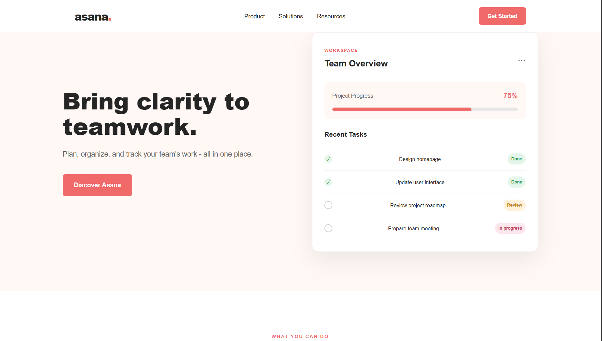
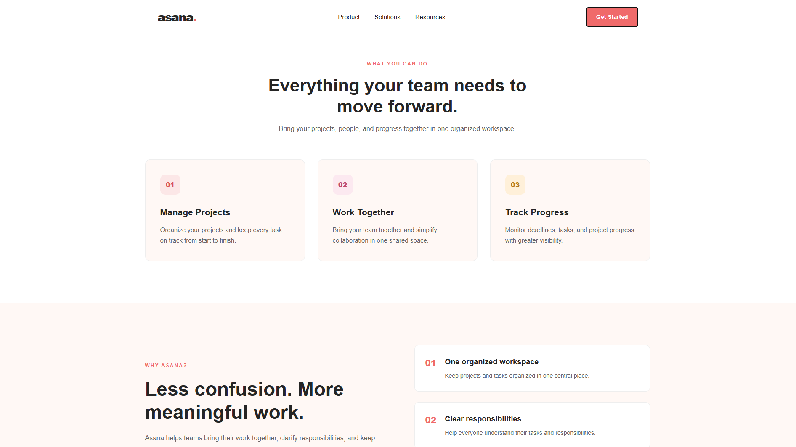
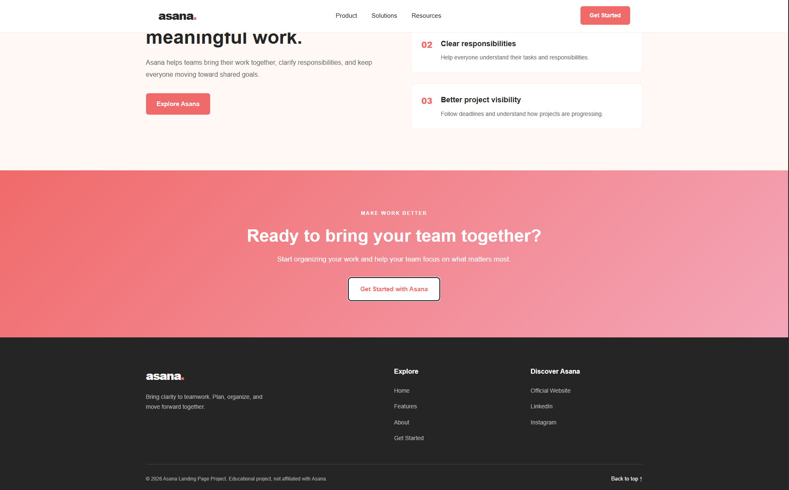
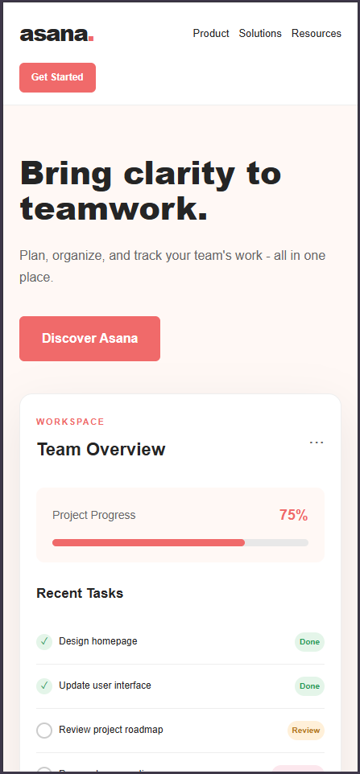
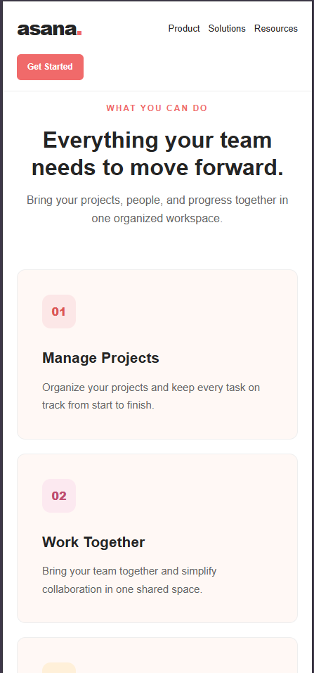
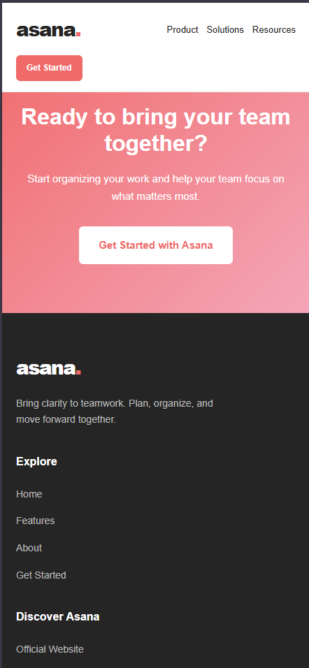

# Asana Landing Page

A modern, responsive landing page inspired by Asana, designed to present its project management and team collaboration features.

This project was developed as part of the **Oasis Infobyte Internship Program – Web Development and Designing, Level 1**.

> **Disclaimer:** This is an independent educational project inspired by Asana. It is not an official Asana website and is not affiliated with or endorsed by Asana, Inc.

## Project Overview

The goal of this project is to create an attractive and user-friendly landing page that introduces Asana and highlights how it helps teams organize projects, manage tasks, and collaborate more effectively.

The page uses a clean layout, a consistent color palette, and responsive design principles to provide a pleasant browsing experience across different screen sizes.

## Screenshots

### Desktop Version





### Mobile Version






## Features

- **Navigation Bar:** Sticky navigation with links to the main sections.
- **Hero Section:** Main headline, introductory text, and call-to-action button.
- **Dashboard Preview:** Visual representation of a project management workspace.
- **Features Section:** Presentation of project management, team collaboration, and progress tracking.
- **About Section:** Highlights the benefits of using Asana.
- **Call-to-Action Section:** Encourages visitors to discover Asana.
- **Footer:** Navigation links, official website, and social media links.
- **Responsive Layout:** Adaptable layout for desktop, tablet, and mobile screens.

## Technologies Used

- **HTML5** – Semantic page structure and content.
- **CSS3** – Styling, layouts, colors, animations, and responsive design.
- **CSS Grid & Flexbox** – Responsive and flexible page layouts.

No JavaScript or CSS frameworks were used.

## Project Structure

```text
WebDev-L1-LandingPage/
│
├── index.html
├── style.css
├── README.md
```

## Getting Started

No installation or additional dependencies are required.

1. Clone the repository:

   ```bash
   git clone https://github.com/Moonligh226/OIBSIP.git
   ```

2. Open the project folder:

   ```bash
   cd OIBSIP/WebDev-L1-LandingPage
   ```

3. Open `index.html` in your web browser.

You can also open the project directly in Visual Studio Code and use the Live Server extension.

## Color Palette

| Color | Hex Code |
|---|---|
| Primary Coral | `#F06A6A` |
| Secondary Pink | `#F4A6B8` |
| Accent Orange | `#FFB067` |
| Background Cream | `#FFF8F5` |
| Main Text | `#252525` |

## Project Status

**Completed:** Main landing page structure and styling.

Final testing, screenshots, and project documentation are part of the submission preparation process.

## Author
ME " Moonligh226"

Developed as a student project for the **Oasis Infobyte Internship Program**.

## Acknowledgements

- [Asana](https://asana.com/) – Design inspiration.
- [Oasis Infobyte](https://oasisinfobyte.com/) – Internship program.
