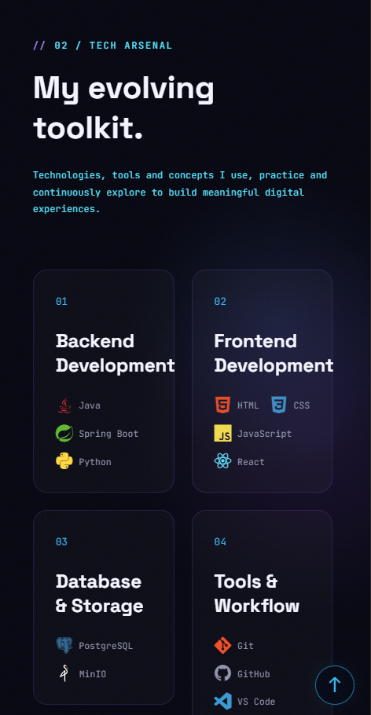
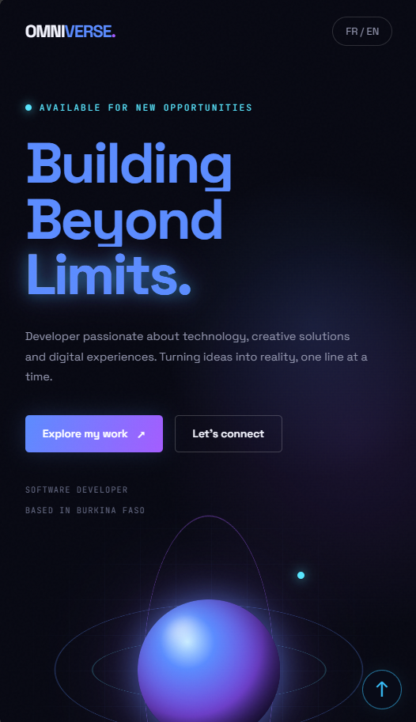
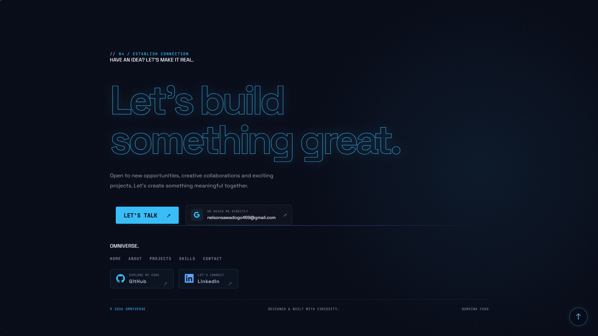
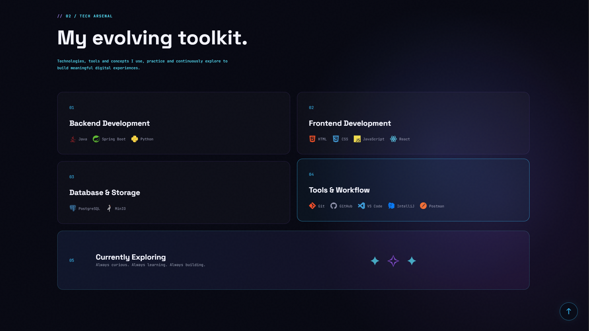
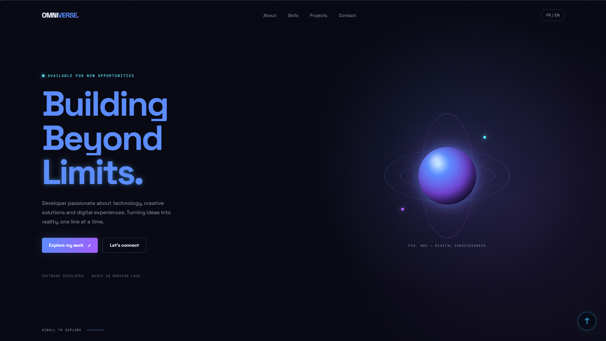
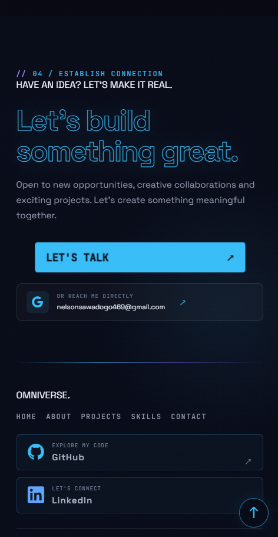

# OMNIVERSE — Personal Developer Portfolio

An interactive, responsive personal portfolio website showcasing web development skills, engineering projects, and contact channels. Built with semantic HTML5, modern CSS3 styling, and fluid GSAP-driven scroll animations.

This project was developed as part of the **Oasis Infobyte Internship Program – Web Development and Designing (OIBSIP), Level 1 – Task 2**.

---

## 📸 Screenshots

### Desktop Version




### Mobile Version
<div align="center">
  
  
  
</div>

---

## 📌 Project Overview

The primary goal of this project is to build an impactful digital identity and interactive résumé. It introduces the developer's background, highlights core technical proficiencies across modern frontend and backend technologies, showcases featured engineering projects, and provides a direct contact interface.

---

## ✨ Features Checklist (Level 1 Task 2 Requirements)

- [x] **Profile / Hero Section:** Name, professional role, tagline ("Building Beyond Limits"), animated atmospheric background glow, and noise overlay.
- [x] **About Me Section:** Personal background, curiosity-driven mindset, and development philosophy.
- [x] **Skills Matrix:** Visual grid of technical proficiencies featuring official Devicon SVG icons (HTML5, CSS3, JavaScript, Vue, React, Node.js, Git, Docker, etc.).
- [x] **Projects Section:** Showcase of featured projects with titles, summaries, tags, and GitHub repository links.
- [x] **Contact Section:** Direct contact channels with interactive hover states and social profiles.
- [x] **Smooth Scroll Navigation:** Fluid navigation with anchor links and back-to-top floating button.
- [x] **Multi-language Support (i18n):** Native bilingual switching between English and French.
- [x] **Consistent Cosmic Branding:** Space Grotesk and JetBrains Mono typography with a deep space color scheme.
- [x] **Fully Responsive Design:** Seamlessly adapts across mobile, tablet, and desktop display resolutions.

---

## 🛠️ Tech Stack & Libraries

- **HTML5:** Semantic markup (`<header>`, `<nav>`, `<main>`, `<section>`, `<footer>`).
- **CSS3:** Custom properties, Flexbox, CSS Grid, glassmorphism, responsive breakpoints.
- **JavaScript (ES6+):** Dynamic theme, i18n localization engine, and DOM manipulation.
- **GSAP (GreenSock):** High-performance scroll-triggered animations and micro-interactions.
- **Devicon:** Vector technology stack iconography.
- **Vite:** Next-generation frontend tooling and development server.

---

## 📂 Project Structure

```text
WebDev-L1-PersonnalPortfolio/
│
├── assets/                 # Icons, images, CV, and graphical assets
├── css/
│   ├── style.css           # Core styling, layout, typography, and responsive rules
│   └── animations.css      # Keyframes and specialized transition effects
├── js/
│   ├── main.js             # Core UI logic, navigation, and event handlers
│   ├── animations.js       # GSAP animation timelines
│   └── translations.js     # Bilingual dictionary (FR / EN)
│
├── screenshots/            # High-resolution Desktop and Mobile previews
│   ├── Desktop1.png
│   ├── Desktop2.png
│   ├── mobile1.png
│   └── mobile2.png
│
├── index.html              # Main HTML entry point
├── package.json            # Project dependencies and build scripts
└── README.md               # Technical project documentation
```

---

## 🚀 Getting Started

The portfolio is designed to run seamlessly both as a standalone static application (zero installation) and through the modern Vite dev environment.

### Quick Start (Standalone / Live Server)
1. Clone the repository:
   ```bash
   git clone https://github.com/Moonligh226/OIBSIP.git
   ```
2. Navigate into the portfolio directory:
   ```bash
   cd OIBSIP/WebDev-L1-PersonnalPortfolio
   ```
3. Open `index.html` directly in any modern browser, or launch it with VS Code **Live Server**. All scripts, GSAP animations, and translations load automatically without any build steps.

---

### Development Mode (Vite)
To work in a local node-based development environment:

1. Install dependencies:
   ```bash
   npm install
   ```

2. Start the Vite development server:
   ```bash
   npm run dev
   ```

3. Open the displayed local URL (typically `http://localhost:5173`) in your browser.

---

## 👤 Author

**Moonligh226**  
Developed for the **Oasis Infobyte Internship Program (OIBSIP)**  
Track: *Web Development & Designing*  
Level: *Level 1 — Task 2*  
Official Hashtag: `#oasisinfobyte`

---

## 🤝 Acknowledgements

- **Oasis Infobyte** – For this practical internship challenge.
- **GSAP (GreenSock)** – For animation libraries.
- **Devicon** – For developer tech icons.
