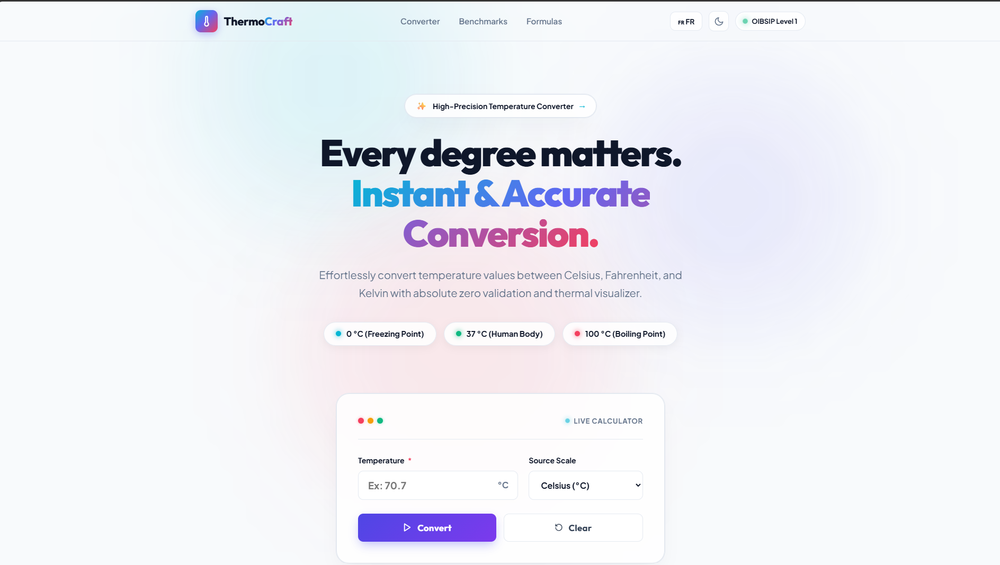
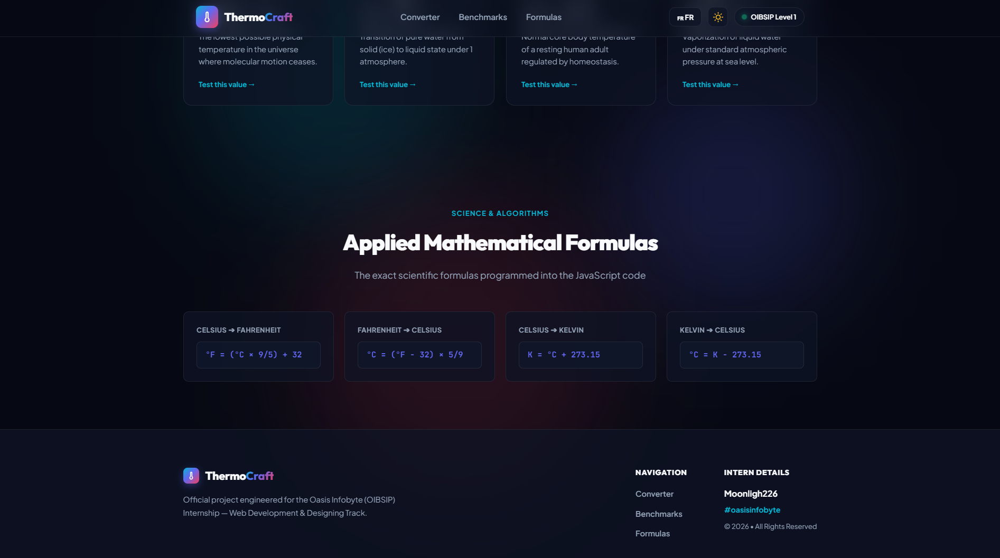
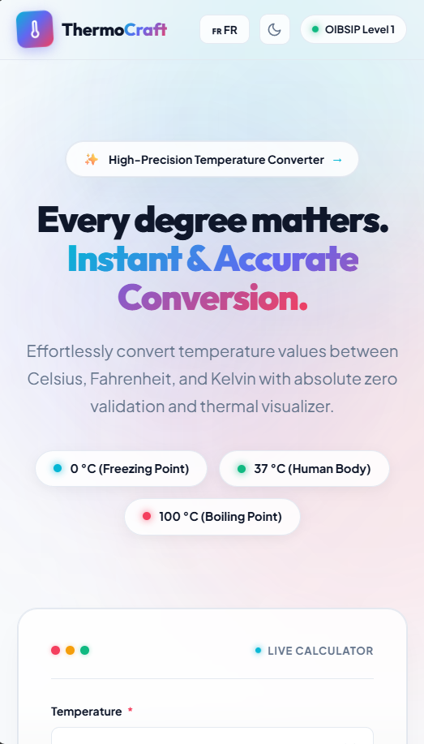
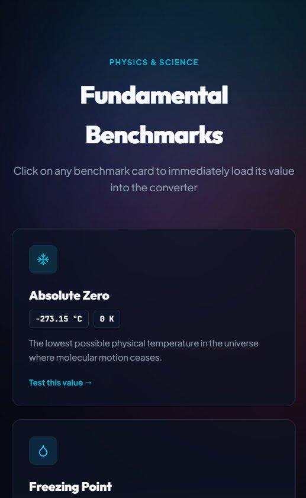

# ThermoCraft Pro — Temperature Converter Website

An interactive, high-precision thermodynamic converter web application that seamlessly translates temperatures across Celsius, Fahrenheit, and Kelvin in real-time, built with vanilla web technologies.

This project was developed as part of the **Oasis Infobyte Internship Program – Web Development and Designing (OIBSIP), Level 1 – Task 3**.

---

## Screenshots

### Desktop Version (Dark & Light Mode)



### Mobile Version (Dark & Light Mode)
<div align="center">
  
  
</div>

---

## Project Overview

The objective of this project is to provide an accurate, user-friendly, and scientifically grounded temperature conversion web tool. It incorporates real-time calculation, edge-case physical enforcement, bilingual localization, dynamic dark/light theming, and an interactive thermal level gauge.

### Key Features Implemented:
- **Instant Multi-Scale Conversion:** Calculates and displays Celsius, Fahrenheit, and Kelvin values simultaneously.
- **Physical Zero Absolu Enforcement:** Automatically intercepts and flags impossible temperatures below Absolute Zero (-273.15°C, -459.67°F, 0 K).
- **Interactive Thermal Gauge:** Visual status bar dynamically qualifying the heat level (Sub-zero, Cool, Mild, Warm, Extreme).
- **Dark / Light Mode:** Native theme switcher with persistence in `localStorage`.
- **Bilingual Internationalization (i18n):** Instant live switching between French (`FR`) and English (`EN`).
- **Interactive Benchmark Cards:** Quick-load cards (Freezing point, Human body, Boiling point, Absolute Zero) that auto-fill the converter on click.
- **Pure Vector SVG Graphics:** Clean, scalable icons without heavy third-party dependencies.
- **Scroll Animations:** Native `IntersectionObserver` reveal effects for optimal performance.

---

## Tech Stack

- **HTML5:** Semantic architecture (`<nav>`, `<header>`, `<main>`, `<section>`, `<footer>`, ARIA attributes).
- **CSS3:** Custom design system with CSS Variables (`:root` & `[data-theme="dark"]`), Flexbox, CSS Grid, smooth scrolling, backdrop filters.
- **JavaScript (Vanilla ES6+):** DOM manipulation, i18n dictionary, event listeners, localStorage management, and math validation.

---

##  Mathematical Formulas

| Source \ Target | Celsius (°C) | Fahrenheit (°F) | Kelvin (K) |
|---|---|---|---|
| **Celsius** | $C$ | $(C \times \frac{9}{5}) + 32$ | $C + 273.15$ |
| **Fahrenheit** | $(F - 32) \times \frac{5}{9}$ | $F$ | $(F - 32) \times \frac{5}{9} + 273.15$ |
| **Kelvin** | $K - 273.15$ | $(K - 273.15) \times \frac{9}{5} + 32$ | $K$ |

**Absolute Zero Limits:**
- Celsius: $\ge -273.15^\circ\text{C}$
- Fahrenheit: $\ge -459.67^\circ\text{F}$
- Kelvin: $\ge 0\text{ K}$

---

##  Project Structure

```text
WebDev-L1-TemperatureConverter/
│
├── screenshots/        # High-resolution Desktop and Mobile previews (Dark/Light)
│   ├── Desktop1.png    # Desktop view (Dark Mode)
│   ├── Desktop2.png    # Desktop view (Light Mode)
│   ├── mobile1.png     # Mobile view (Dark Mode)
│   └── mobile2.png     # Mobile view (Light Mode)
│
├── index.html          # Semantic HTML structure & accessible components
├── style.css           # Complete design system (Dark/Light tokens, animations, responsive)
├── script.js           # Conversion formulas, i18n engine, theme toggle, DOM logic
└── README.md           # Technical documentation and evaluation guidelines
```

---

## Getting Started

No compilation, bundler, or external package installation required.

1. Clone the repository:
   ```bash
   git clone https://github.com/Moonligh226/OIBSIP.git
   ```
2. Navigate into the task folder:
   ```bash
   cd OIBSIP/WebDev-L1-TemperatureConverter
   ```
3. Open `index.html` in your web browser or launch via VS Code Live Server.

---

## Author

**Moonligh226**  
Developed for the **Oasis Infobyte Internship Program (OIBSIP)**  
Track : *Web Development & Designing*  
Hashtag officiel : `#oasisinfobyte`

---

## Acknowledgements

- **Oasis Infobyte** – For this practical internship challenge.
- **MDN Web Docs** – Documentation on DOM manipulation, localStorage, and client-side validation.
