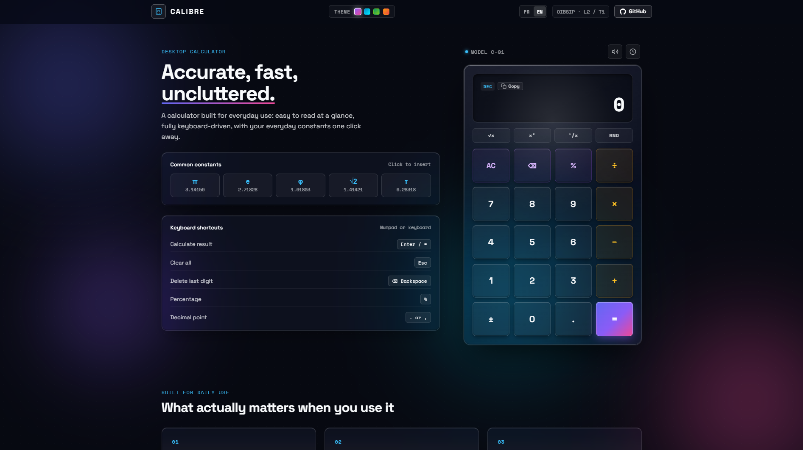
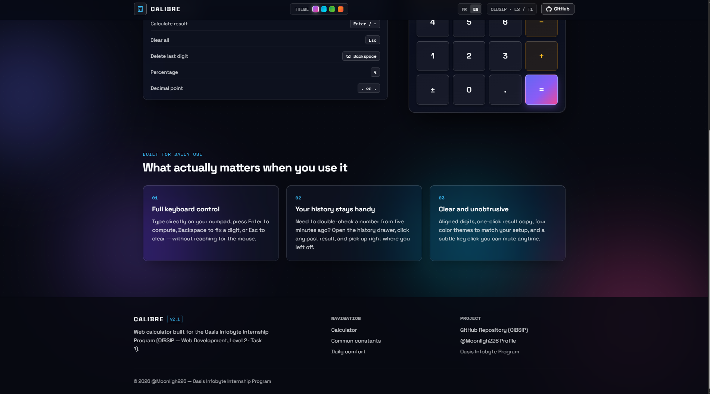
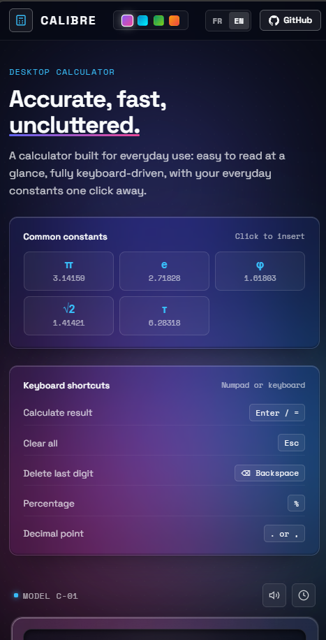
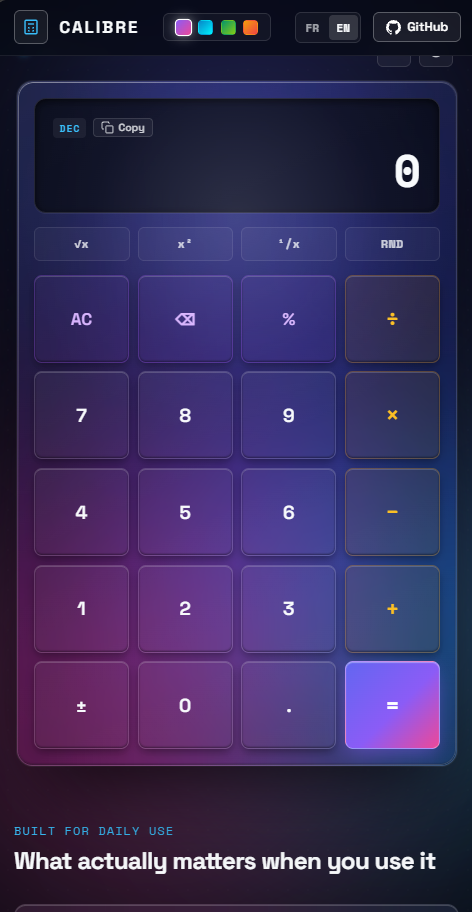

# CALIBRE — Web Calculator

A responsive, keyboard-driven web calculator featuring a refined glassmorphic interface, four real-time color themes, bilingual localization (FR/EN), procedural Web Audio feedback, and persistent calculation history.

This project was developed as part of the **Oasis Infobyte Internship Program – Web Development and Designing (OIBSIP), Level 2 – Task 1**.

---

## Screenshots

### Desktop Version



### Mobile Version
<div align="center">
  
  
</div>

---

## Project Overview

The objective of this project is to build a fast, reliable, and pleasant everyday calculator without visual clutter or external dependencies. It combines a deterministic 64-bit arithmetic engine with an architectural glass UI, full keyboard navigation, and accessible controls.

### Key Features Implemented:
- **Four Real-Time Themes:** Live theme switcher (*Aurora*, *Cyber*, *Emerald*, *Solar*) persisted in `localStorage`.
- **Bilingual Internationalization (i18n):** Instant switching between French (`FR`) and English (`EN`) with persistence in `localStorage`.
- **Full Keyboard Support:** Numpad (`0-9`), operators (`+`, `-`, `*`, `/`), `Enter` / `=` to calculate, `Esc` to clear, `Backspace` to delete, `%`, and `.` or `,` for decimals.
- **Common Constants & Quick Functions:** One-click insertion of $\pi$, $e$, $\varphi$, $\sqrt{2}$, and $\tau$, plus $\sqrt{x}$, $x^2$, $1/x$, and `RND`.
- **One-Click Copy & History Drawer:** Copy button built into the display header and a slide-in history drawer storing the last 20 calculations in `localStorage`.
- **Safe Arithmetic Engine (No `eval()`):** Deterministic parsing with IEEE 754 floating-point rounding correction and division-by-zero protection.
- **Procedural Tactile Audio:** Subtle key-press tones synthesized with the native Web Audio API (toggleable mute state persisted in `localStorage`).
- **Accessibility:** Visible `:focus-visible` outlines, ARIA labels, `aria-live` result announcements, and full `prefers-reduced-motion` support.

---

## Tech Stack

- **HTML5:** Semantic structure (`<header>`, `<main>`, `<section>`, `<aside>`, `<footer>`, ARIA attributes).
- **CSS3:** Custom properties, CSS Grid, Flexbox, backdrop-filter glassmorphism, tabular numerals, and responsive media queries.
- **JavaScript (Vanilla ES6+):** Object-oriented calculator engine, i18n dictionary, Web Audio API synthesis, clipboard integration, and `localStorage` persistence.

---

## Project Structure

```text
WebDev-L2-Calculator/
│
├── screenshots/        # Desktop and Mobile previews
│   ├── Desktop1.png
│   ├── Desktop2.png
│   ├── mobile1.png
│   └── mobile2.png
│
├── index.html          # Semantic HTML structure and accessible controls
├── style.css           # Themes, glassmorphism styling, layout, and responsive rules
├── script.js           # Arithmetic engine, i18n (FR/EN), Web Audio API, and history
└── README.md           # Project documentation
```

---

## Getting Started

No compilation, bundler, or external package installation is required.

1. Clone the repository:
   ```bash
   git clone https://github.com/Moonligh226/OIBSIP.git
   ```
2. Navigate into the task folder:
   ```bash
   cd OIBSIP/WebDev-L2-Calculator
   ```
3. Open `index.html` in your web browser or launch it via VS Code Live Server.

---

## Author

**Moonligh226**  
Developed for the **Oasis Infobyte Internship Program (OIBSIP)**  
Track: *Web Development & Designing*  
Official Hashtag: `#oasisinfobyte`

---

## Acknowledgements

- **Oasis Infobyte** – For organizing this practical internship program.
- **MDN Web Docs** – Documentation on the Web Audio API, Clipboard API, and `localStorage`.
